# 论文图表改进 · 负责人审核

**范围：Fig. 1、3、4、5、6、7，以及 Table 1、2。Fig. 2 不改。**

基于已有 Overleaf 代码逐项修改；保留原字体家族、配色和实验结果。本文档链接的均为最后一次局部审核版本，未使用早先七图统一重绘版本。未改 Overleaf，也未覆盖仓库现有论文、训练或评测文件。

先看 [全部前后对比 PDF](all-comparisons.pdf)，再看 [正文/图注同步清单](TEXT_SYNC.md)。后者列出必须同步的 Fig. 7 图注及 Table 1 移出参数的正文位置。

| 图表 | 改动原因 | 修改版 |
|---|---|---|
| Fig. 1 | 减少四层概览中的重复示意，突出模型插槽和主检验 | [PDF](revised/fig1.pdf) |
| Fig. 3 | 分开延迟补偿与未来预测；解决拥挤说明和箭头对应不清 | [PDF](revised/fig3.pdf) |
| Fig. 4 | 明确 L2/L3 评分对象及加权执行计划，调整分数位置 | [PDF](revised/fig4.pdf) |
| Fig. 5 | 分开模型/预算图例与相关统计，改善标签和点的对应 | [PDF](revised/fig5.pdf) |
| Fig. 6 | 分组标题独立成行；方法、训练预算与条形逐行对齐 | [PDF](revised/fig6.pdf) |
| Fig. 7 | 区分主检验、条件分析、探索性剔除；移除全图区间底色 | [PDF](revised/fig7.pdf) |
| Table 1 | 分三类设置，拆分长单元格，明确两档预算 | [PDF](revised/table1.pdf) |
| Table 2 | 独立预算列、强化分组，明确样本口径并压缩表注 | [PDF](revised/table2.pdf) |

## 前后对比

原版与改版分别保留，图片展示的是版式，不表示增加了实验数据。

### Fig. 1

减少四层概览中的重复示意，突出模型插槽和主检验。

| 修改前 | 修改后 |
|---|---|
| 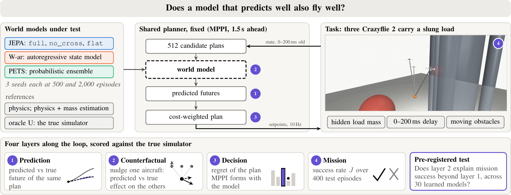 | 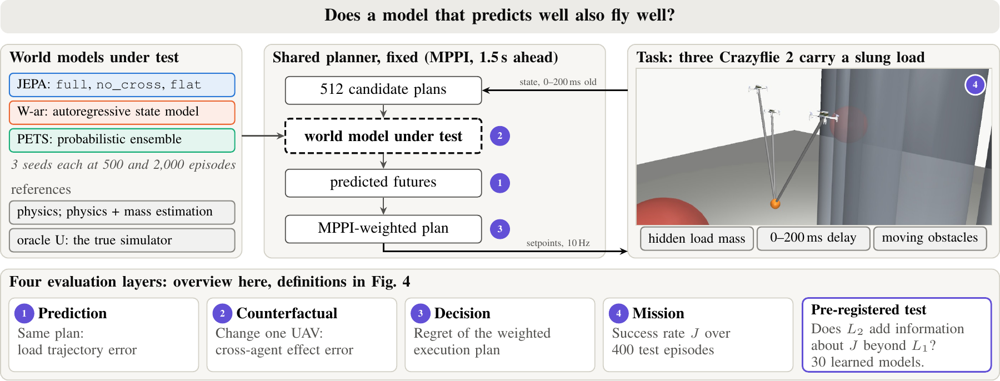 |

### Fig. 3

分开延迟补偿与未来预测；解决拥挤说明和箭头对应不清。

| 修改前 | 修改后 |
|---|---|
| 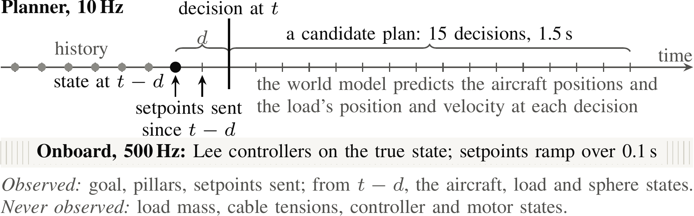 | 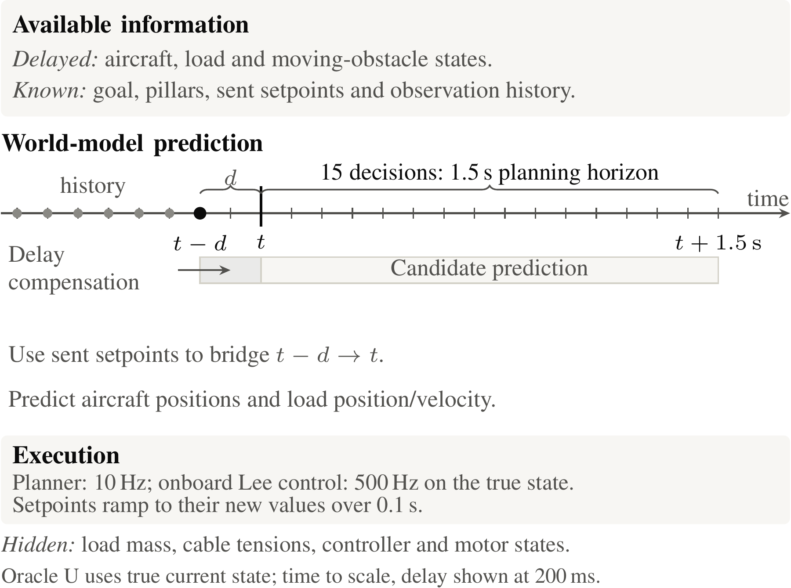 |

### Fig. 4

明确 L2/L3 评分对象及加权执行计划，调整分数位置。

| 修改前 | 修改后 |
|---|---|
| 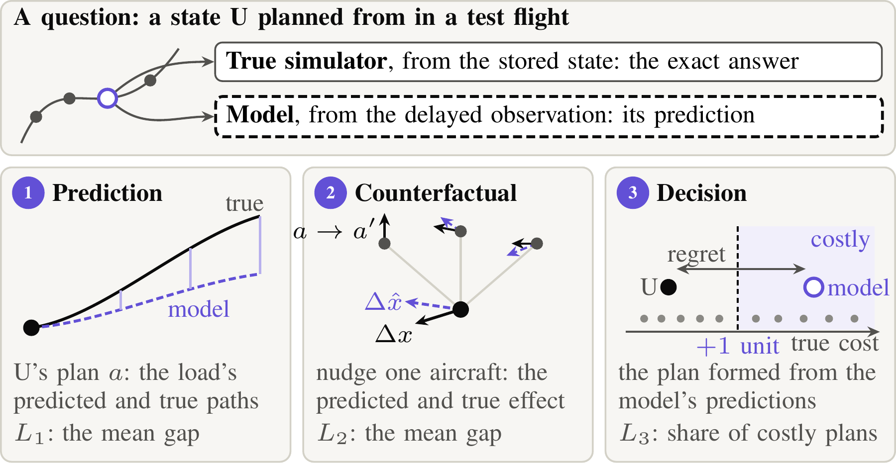 | 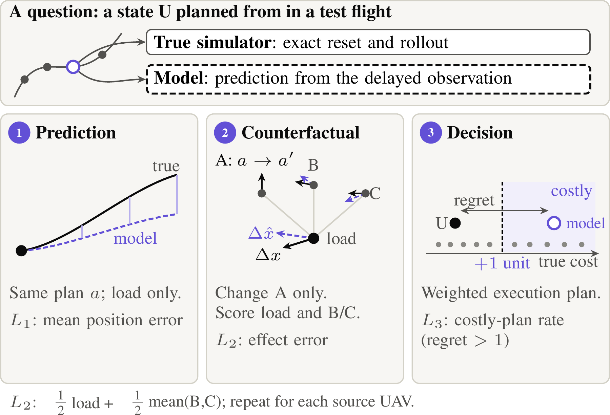 |

### Fig. 5

分开模型/预算图例与相关统计，改善标签和点的对应。

| 修改前 | 修改后 |
|---|---|
| 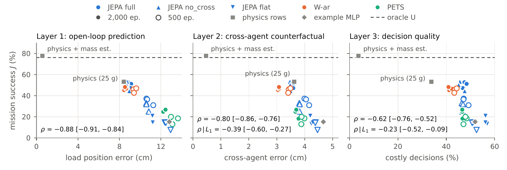 | 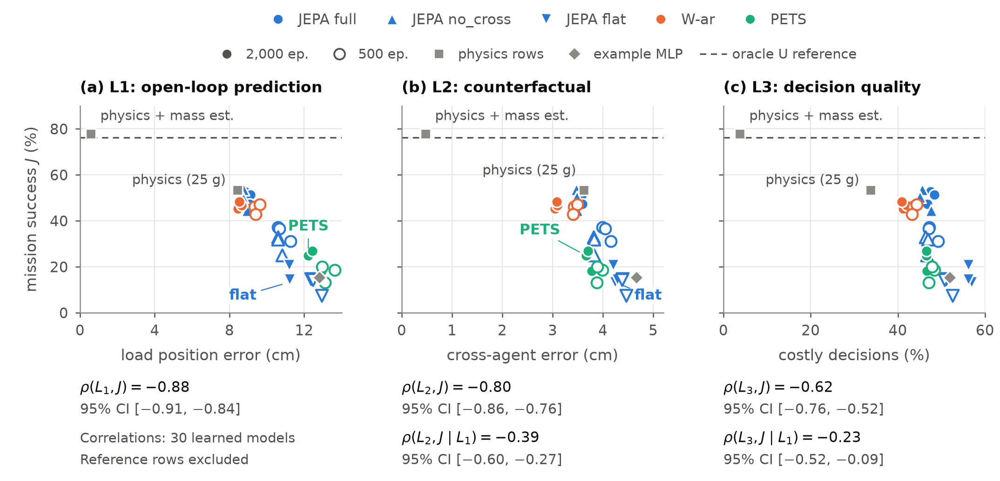 |

### Fig. 6

分组标题独立成行；方法、训练预算与条形逐行对齐。

| 修改前 | 修改后 |
|---|---|
| 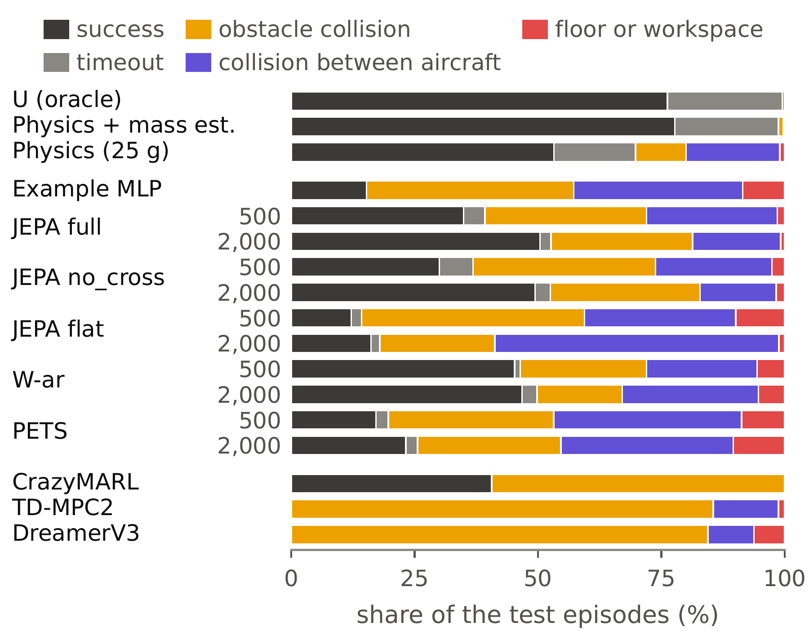 | 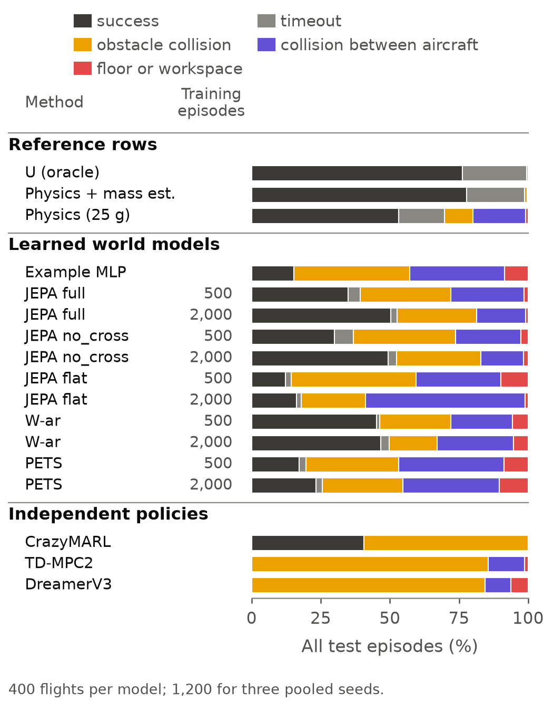 |

### Fig. 7

区分主检验、条件分析、探索性剔除；移除全图区间底色。

| 修改前 | 修改后 |
|---|---|
| 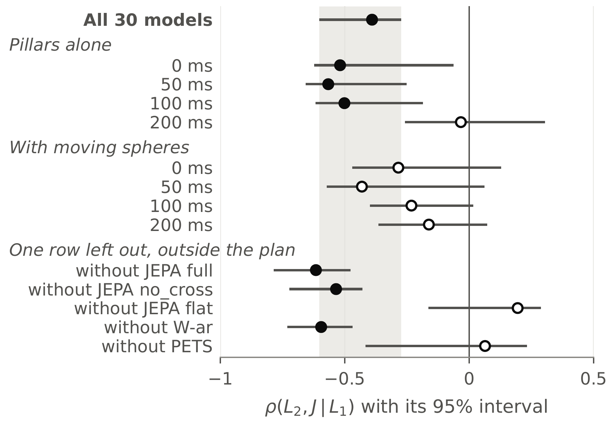 | 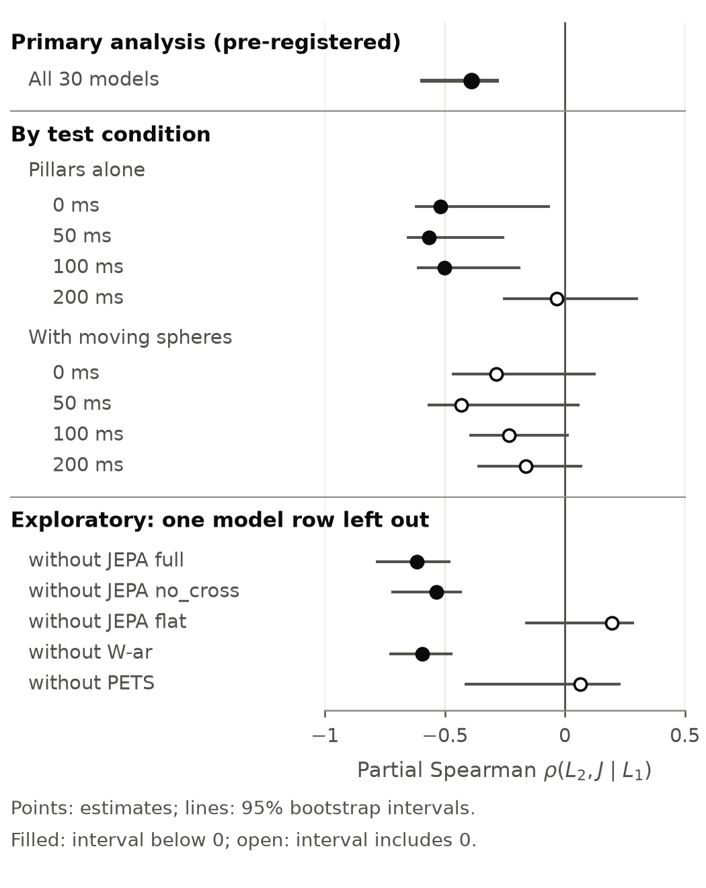 |

### Table 1

分三类设置，拆分长单元格，明确两档预算。

| 修改前 | 修改后 |
|---|---|
| 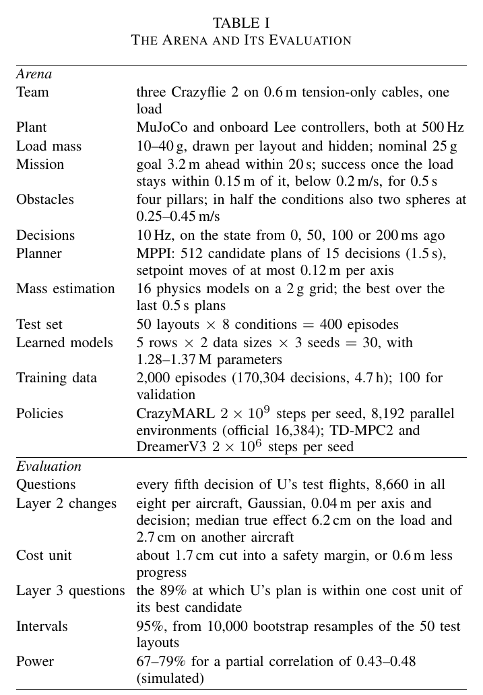 | 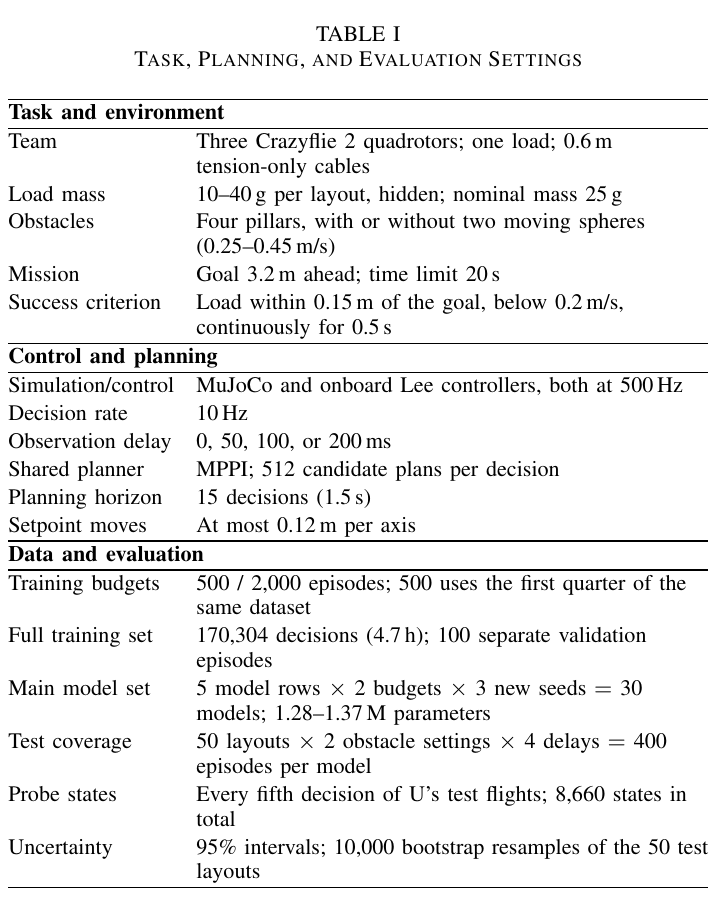 |

### Table 2

独立预算列、强化分组，明确样本口径并压缩表注。

| 修改前 | 修改后 |
|---|---|
| 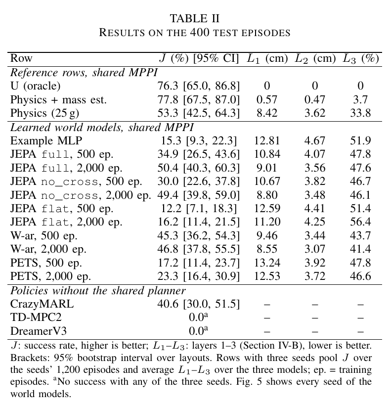 | 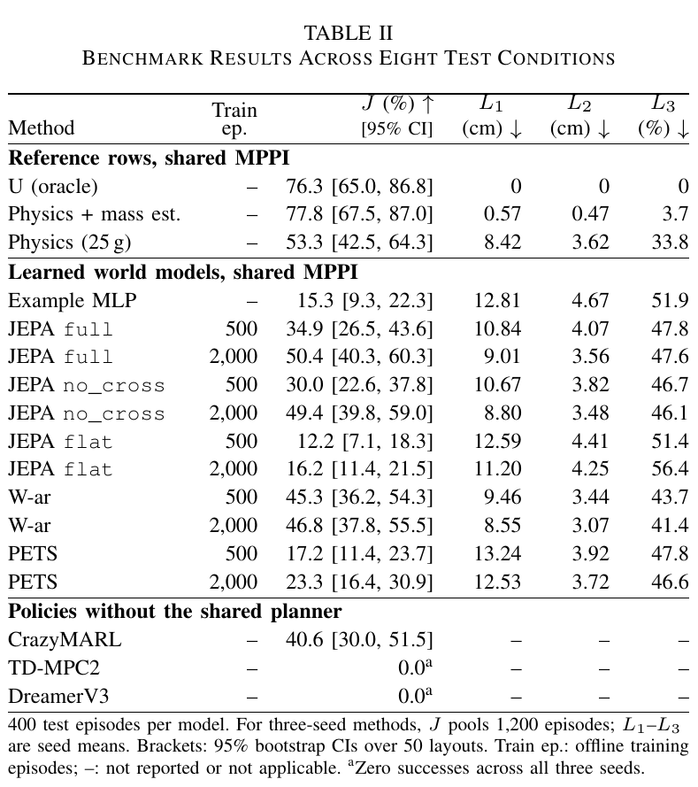 |

## 文件与复核

- `figures/`：TikZ 源码、原场景裁切图及三个绘图脚本。绘图脚本调用方式沿用原代码：`python figures/src/plot_layers.py <output_stem>`，其余两脚本同理；需要现有 Matplotlib。
- `tables/`：两个完整 LaTeX 表格，保留原 label；使用 IEEEtran 原 serif 字体和原表格字号。
- `text/`：图注替换及正文参数转移建议，不会自动写入论文。
- `*_validation.json`：局部渲染/坐标/数值验证；`manifest.json`：包内文件 SHA256。
- 原表 17 行结果和全部 CI 逐字保留；Fig. 5 散点、Fig. 6 计数和 Fig. 7 的 14 个估计/区间均已与源代码核对。
- 图表已独立渲染检查；两表编译无 overfull box。最终论文排版和八页限制仍需负责人整合后重新检查。

此 PR 提供审核材料，合并后也不会自动更新 Overleaf。审批后可按 `TEXT_SYNC.md` 整合。
