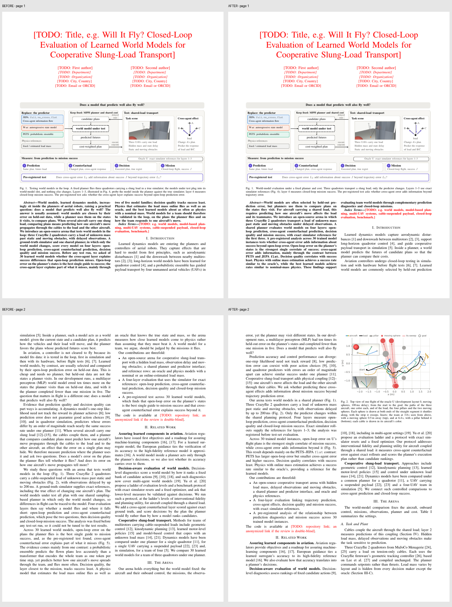

# 论文文字精简审核包

只修改已有正文和 Fig. 1/5/6 图注；TODO 原样保留。Overleaf 未改，实验未重跑。

## 建议审核顺序

1. **[逐段前后对照](BEFORE_AFTER.md)**：按章节索引，展开查看 45 处修改。
2. **正文行级 diff**：见本 PR 的 `refactor(paper): tighten existing prose and clarify model instances` 提交；该提交的父提交保存修改前版本，因此 diff 只展示实际改文，不需要在整份新加文件中查找。
3. **[改前 PDF](before.pdf) / [改后 PDF](after.pdf)**：同一模板与本地素材，9 → 8 页。下图只是前两页排版对照，不代表逐段位置对应。
4. **[修改依据与原因](RATIONALE.md)**、[按章节字数与验证](CHANGELOG.md)、[机器可读检查](VALIDATION.json)。



## 范围与结果

- 去掉重复设问、结果复述和长定义的重复展开，明确正文与图表的分工。
- 约 4,078 → 2,646 词，减少 35.1%。采用同一近似规则，排除 TODO、图表、显示公式、注释等，不是官方 word count。
- 30 个模型实例、16 个候选质量、Lee controller、输入权限和统计限定保留。
- 两表、公式、引用与图像输入路径一致；所有 TODO 行逐字不变。
- 最终编译无错误/未定义引用/Overfull，仍有 4 条 Underfull 排版提示；未通过缩字体或挤字距处理。
- 仓库目标分支尚无论文源码，本目录是供负责人整合的独立审核包，不覆盖其他作者文件。与图表审核 PR #4 相关，但可独立阅读。

## 源码与复现

`manuscript/main.tex` 为改稿；其修改前版本保存在 baseline 提交。图表、照片与 bibliography 是已有论文素材，仅为独立编译附入。

在安装 IEEEtran、TikZ 与常用宏包的 TeX 环境中：

```sh
cd manuscript
pdflatex -interaction=nonstopmode -halt-on-error main.tex
bibtex main
pdflatex -interaction=nonstopmode -halt-on-error main.tex
pdflatex -interaction=nonstopmode -halt-on-error main.tex
```

浮动体可能需要额外一次 LaTeX 运行直至交叉引用稳定。审阅的是现有文字，不代表 TODO 或引用补齐已完成。
