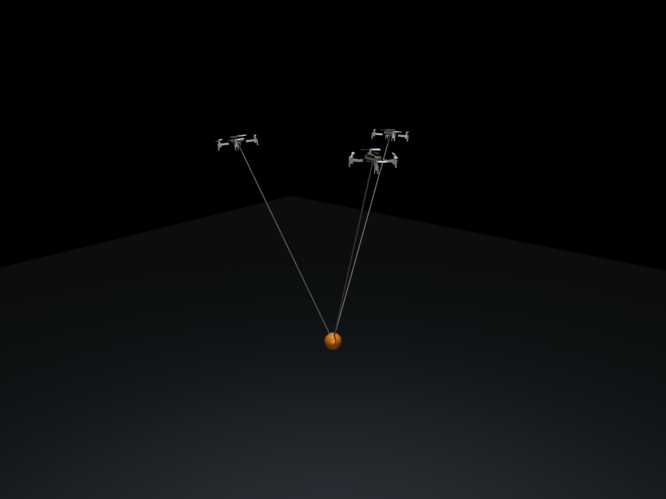

# Public-airframe UAV transport and external baseline evidence

[English research report](../../../docs/uav-external-baselines.md) ·
[Archived self-built baseline](../../../archives/uav_transport/self_built_v2/README.md)

This package records the new experiments on the pinned official Menagerie
Crazyflie 2 airframe. Every copied file retains its original bytes. `index.json`
maps copies and summaries to their original files and SHA256 digests; raw
trajectories and local training examples remain under the ignored `data/` tree.

| Evidence | Contents |
|---|---|
| [summary.json](summary.json) | Physical audit, fresh local data, matched candidate budgets, 192 model/study-control missions, 24 external-controller missions and refinement checks |
| [mission_menagerie_v1.json](mission_menagerie_v1.json) | All 192 completed mission records, frozen model hashes and registered task definitions |
| [menagerie_external_lee_v1.json](menagerie_external_lee_v1.json) | All 24 missions with unchanged upstream Lee feedback gains and explicit source/clock/calibration attribution |
| [menagerie_external_lee_v1_review.json](menagerie_external_lee_v1_review.json) | Complete external-controller memory, paired-prefix, score and source verification |
| [models/](models/) | Six newly trained and frozen local predictors with original metadata, registration and manifest |
| [menagerie_integration_audit.json](menagerie_integration_audit.json) | Exact compiled-airframe comparison and targeted physical checks |
| [CPU IPPO integration](crazymarl_ippo_cpu_smoke_v3.json), [GPU IPPO integration](crazymarl_ippo_gpu_smoke_v3.json) | Real upstream updates, changed actor weights, finite native rollouts and exact checkpoint reload; explicitly unconverged |
| [Checkpoint availability](crazymarl_checkpoint_availability.json) | Recorded upstream release, branch and artifact inspection |
| [lee_refinement_boundary.json](lee_refinement_boundary.json), [quarter-ms check](lee_refinement_quarter_ms.json) | The retained external-controller trajectory exception and additional finer-grid diagnostics |
| [verified_inputs.json](verified_inputs.json) | Verified source, raw-data, model and evaluation-input hashes |

All 216 complete missions deliver. Constrained completion with the original
5 cm excursion and 0.6 N donor-tension limits is:

| Predictor/controller | Original geometry | Cooperative reconfiguration |
|---|---:|---:|
| Small frozen world model | 0/36 | **36/36** |
| Large frozen world model | 0/36 | **36/36** |
| Exact option prediction | 0/12 | **12/12** |
| Study feedback | 0/12 | **12/12** |
| Upstream Lee flight feedback, shared payload allocation | 0/12 | **10/12** |

All nominal full-state replays are bitwise identical and every task score is
preserved at 1 ms. Trajectory thresholds pass for 192/192 model/study runs and
23/24 external-Lee runs. The latter exception and its additional 0.5/0.25 ms
replays remain explicit in the evidence; thresholds were not changed.

## Run the published frozen predictors

Restore the expected local model cache from the repository root:

```bash
mkdir -p data/uav_transport_external
cp -n experiments/uav_transport/menagerie_v1/models/* data/uav_transport_external/
OMP_NUM_THREADS=1 OPENBLAS_NUM_THREADS=1 data/uav_transport/.venv/bin/python \
  -m uav_transport.mission --plant menagerie_crazyflie_2 \
  --models data/uav_transport_external/models_menagerie_v1_manifest.json \
  --out data/uav_transport_external/fresh_mission_reproduction --workers 8
```

Use a fresh output prefix for each run. The research report supplies commands
for new local data, training, external-controller execution and CPU/GPU
CrazyMARL setup. Full IPPO performance evaluation requires task alignment and
converged policy training; the integration checkpoints are labeled accordingly.


